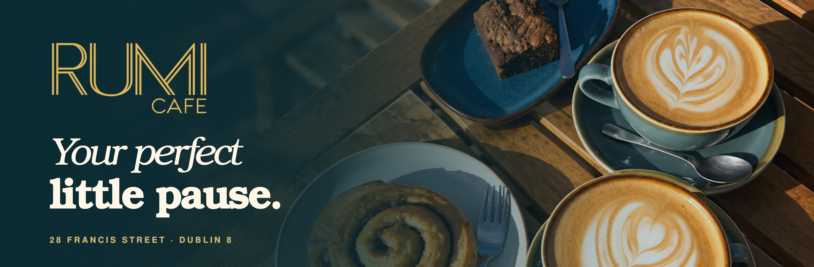
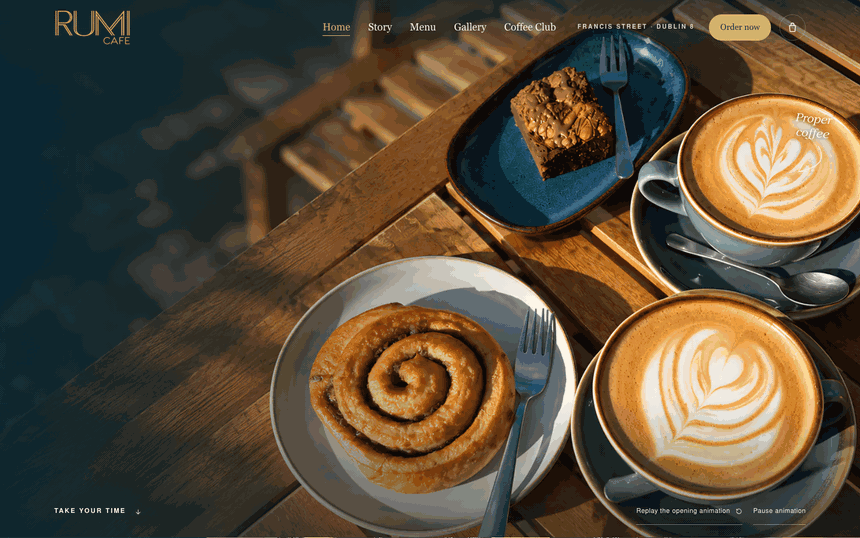
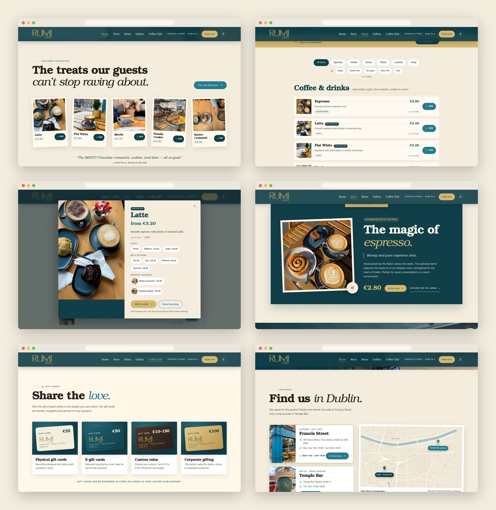
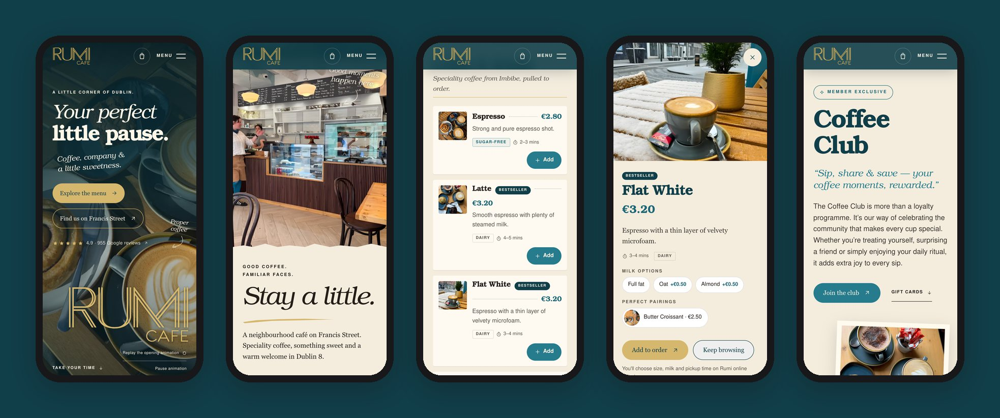
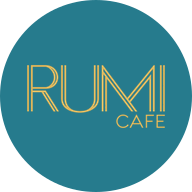

<div align="center">



<h3>A multi-page website for a Turkish-Irish café in Dublin 8, opened by steam that writes the RUMI signature.</h3>

<p>
  <a href="https://rumi-cafe-francis-street.vercel.app"><strong>🌐 Live site</strong></a>
  &nbsp;·&nbsp;
  <a href="#hero-animation"><strong>🎬 How the hero works</strong></a>
  &nbsp;·&nbsp;
  <a href="#getting-started"><strong>🛠️ Run it locally</strong></a>
</p>

<p>
  <a href="https://rumi-cafe-francis-street.vercel.app"></a>
  
  
  
  
</p>

</div>

<br />

## 🚀 Overview

**Rumi Cafe** is a family-run café on Francis Street, in the Liberties, founded by the Balkir sisters: speciality coffee, Turkish delight on the house and a teal storefront everyone recognises. The site is built around the idea in its headline, **your perfect little pause**: real photos of the table, the counter and the street, warm paper sheets and handwritten notes laid over them, and an opening where the steam from a latte draws the café's own signature.

Every section of Rumi's online ordering site is here (menu, story, gallery, Coffee Club, gift cards, reviews, locations, legal pages) in the café's own visual language. **Adding to the bag and paying stay on the ordering site**: every *Add*, *Order now*, bag and *Join the club* button hands the visitor over to it.

- **A real place, not a template**: photos of the café, its counter, its cups and its regulars carry every page down to the footer
- **A full menu without a checkout**: 18 items with search, category and dietary filters, sizes, milk options and pairings; ordering finishes on the ordering site
- **Built for every visitor**: everything readable without JavaScript, a still opening with reduced motion, keyboard and screen-reader friendly dialogs
- **Light**: 520 KB to open the home page on a phone, 662 KB on a 1440 px screen

<br />

<a name="hero-animation"></a>

## 🎬 The hero animation

<div align="center">
  <a href="https://rumi-cafe-francis-street.vercel.app"></a>
  <sub>The 2.85 s opening on the live site, then a scroll into <em>Stay a little.</em> · captured at 1440 × 900</sub>
</div>

<br />

The opening is a short gesture, not a loading screen: the headline is readable from the first frame and nothing holds the scroll. It follows the kit's motion script:

| Time        | What happens                                                                 |
| :---------- | :--------------------------------------------------------------------------- |
| 0.00–0.85 s | The table photo settles from 103.5% to 100%                                  |
| 0.15–1.60 s | Three fine lines of steam rise from the latte and fade                       |
| 0.45–1.35 s | Headline, note and buttons rise 18 px into place                             |
| 1.00–2.55 s | Gold lines trace the outline of every letter of **RUMI CAFE**, left to right |
| 2.20–2.85 s | The lines give way to the filled signature                                   |
| 2.85 s      | Still scene; the first photo drifts at most 24 px while you scroll           |

**Under the hood**

- ✍️ **The real signature, traced.** The kit's gold logo was cleaned (fringes and specks removed, flat gold) and its outlines traced with OpenCV into 3.5 KB of SVG paths. The lines that draw are the edges of the actual letters, so the drawing lands exactly on the logo instead of crossfading from an approximation.
- 🧵 **One path per contour.** Each outline is its own `<path pathLength="1">` animated with `stroke-dashoffset`, with `vector-effect: non-scaling-stroke` so the line stays crisp at any size; a separate even-odd fill layer fades in at the end.
- ⏯️ **Replay and Pause.** Both buttons sit at the bottom of the hero; Pause freezes the steam and the lines but never leaves the headline half-faded, and is remembered for the visit.
- 🐢 **Graceful by default.** With `prefers-reduced-motion` (or without JavaScript) the page opens on the final frame: photo, headline and filled signature, no steam, no drift.

<br />

## 🖥️ Sections

<div align="center">
  
</div>

<br />

| #   | Page / section                         | Path                       | Role                                                                                  |
| :-- | :------------------------------------- | :------------------------- | :------------------------------------------------------------------------------------ |
| 01  | **Your perfect little pause.**         | `/`                        | Opening, menu and directions buttons, Google rating                                   |
| 02  | **Stay a little.**                     | `/#our-place`              | Torn paper sheet over the real counter                                                |
| 03  | **The treats our guests can't stop raving about.** | `/#favourites` | Five bestsellers as polaroids, each with *Add*                                        |
| 04  | **A moment worth keeping.**            | `/#coffee`                 | Full-bleed table photo and the paper ribbon                                           |
| 05  | **Why choose Rumi?**                   | `/#why-rumi`               | Turkish delight, coffee, pastries, welcome; hours and heritage strip                  |
| 06  | **What our guests are saying.**        | `/#reviews`                | Six Google reviews in a swipeable carousel over the storefront at night               |
| 07  | **Gifts & loyalty.**                   | `/#gifts`                  | Coffee Club and gift cards, link to the club page                                     |
| 08  | **Same great coffee, right here.**     | `/#visit`                  | The real facade, address, hours, a live "open now" status, directions                 |
| 09  | **Find us in Dublin.**                 | `/#find-us`                | Francis Street and the Temple Bar pop-up on a street map drawn from OpenStreetMap      |
| 10  | **Take a little Rumi with you.**       | `/#around`                 | The takeaway cup, Instagram and ordering                                              |
| 11  | **A sanctuary in The Liberties.**      | `/story/`                  | The Balkir sisters, what to expect, the sisters' weekly pick                          |
| 12  | **Our menu.**                          | `/menu/`                   | Search, categories, dietary filters, item dialogs, recently viewed, best picks        |
| 13  | **Our legacy in Dublin.**              | `/gallery/`                | 2020–2023 timeline and a filtered photo archive with a lightbox                       |
| 14  | **Coffee Club**                        | `/coffee-club/`            | Stamp card, gift cards, eight member perks, *Join the club*                           |
| 15  | Privacy · Terms · Accessibility · 404  | `/privacy/` `/terms/` `/accessibility/` | Plain statements of what this site actually does                           |

<br />

## 📱 Mobile first, motion optional

<div align="center">
  
</div>

<br />

- The hero uses the original portrait photo of the table, with the signature at the bottom
- Paper sheets become low panels under each photo; photos stay full width as top bands
- Favourites, filters and gallery tabs scroll sideways; the item dialog goes full screen
- Every touch target is at least 40 px tall (buttons 44 px or more); no horizontal scroll from 320 px up
- Nothing depends on hover

<br />

## ✨ Highlights

- **🛒 Ordering hand-off, no fake checkout**: *Add*, *Order now*, the bag and *Join the club* open Rumi's online ordering site, where size, milk, pickup time and payment are chosen; the menu says so before anyone taps
- **🔎 A menu that works with or without JavaScript**: all 18 items are in the HTML; scripts add search, *Specials* (bestsellers), five dietary filters, an empty state and a live count
- **🪟 Item dialogs and deep links**: a native `<dialog>` with sizes, milk prices, prep time, tags and pairings; `/menu/#flat-white` opens Flat White directly, the home favourites link straight to their dialog
- **🕒 "Open now" in Dublin time**: computed from the same hours that are printed in the page (`Europe/Dublin`), never instead of them
- **🗺️ A real street map**: drawn from OpenStreetMap data (44 KB of SVG), with both pins inside the drawing so they stay exact at every size, plus the café's own Google Maps place link
- **🖼️ Image pipeline**: originals kept as masters, crops that hide review-viewer chrome, Real-ESRGAN ×2 on the Apple GPU, WebP srcsets with versioned names
- **♿ Accessible components**: skip link, labelled filter groups with `aria-pressed`, focus returned after dialogs and the phone menu, Escape everywhere, alt text on every photo
- **🔎 Ready to share**: Open Graph image, `CafeOrCoffeeShop` structured data with opening hours, canonical URLs and favicons

<br />

## 💻 Tech stack

| <br />Vite 6 | <br />JavaScript | <br />HTML5 | <br />CSS3 | <br />Python | <br />Vercel |
| :---: | :---: | :---: | :---: | :---: | :---: |

### Why this stack?

- **Vite + plain JavaScript**: nine static pages rendered at build time from one data file (`src/data/site.js`) by a small Vite plugin; 13 KB of script adds the interactive parts
- **CSS animations and SVG**: the opening needs no animation library and no video, and it can be paused, replayed or skipped
- **Python tooling**: OpenCV for the logo clean-up and trace, Real-ESRGAN for the photos, OpenStreetMap data for the map, fontTools to subset the fonts
- **Self-hosted URW Bookman and Nimbus Sans**: the kit's typefaces as 21–28 KB WOFF2 subsets, no third-party font requests
- **Vercel**: every push to `main` deploys automatically

<br />

## 🎨 Design system

| Token       | Value                                                                        | Use                                         |
| :---------- | :--------------------------------------------------------------------------- | :------------------------------------------ |
| Teal        |  | Buttons, gifts section, the storefront blue |
| Deep teal   |  | Header, reviews, footer, overlays           |
| Gold        |  | Signature, primary buttons, fine lines      |
| Paper       |  | Paper sheets, page background               |
| Coffee      |  | Body text                                   |
| Cream       |  | Text on photos, light sections              |

- **Type**: URW Bookman Demi for display, URW Bookman Light Italic for the editorial gesture, Nimbus Sans for navigation and small print; hero headline 72–128 px on desktop, 48–66 px on phones
- **Scrapbook rules**: at most one paper sheet and two handwritten notes per scene; photos are backgrounds, never a generic card grid; the logo never covers faces or signage
- **Motion**: sheets settle 26 px and −2° over 650 ms; first photo drifts at most 24 px; no loops, no scroll locking

<br />

<a name="getting-started"></a>

## 🛠️ Getting started

```bash
# Clone the repository
git clone https://github.com/Jeanfr1/rumi-cafe-francis-street-website.git
cd rumi-cafe-francis-street-website

# Install dependencies (Node 20.10+)
npm install

# Start the dev server  →  http://localhost:5173
npm run dev

# Production build  →  dist/
npm run build

# Preview the production build  →  http://localhost:4192
npm run preview

# Full QA (widths 320–1920, no-JS, reduced motion, real clicks) against the preview
npm run qa
```

Asset pipeline (only when sources change; Python is `~/anaconda3/bin/python3`, the Real-ESRGAN weights live in `~/.cache/realesrgan/`):

```bash
npm run upscale   # Real-ESRGAN x2 of the photos flagged in src/data/photos.json
npm run logo      # clean the gold logo + trace its outlines (src/data/logo-trace.json)
npm run images    # WebP srcsets, logo, favicons, share image → public/img/*-v1-*
npm run fonts     # subset the URW faces to WOFF2
npm run map       # street map from OpenStreetMap → src/data/map.svg
```

<br />

## 📁 Project structure

```
rumi-cafe-francis-street-website/
├── index.html, story/, menu/, gallery/, coffee-club/,
│   privacy/, terms/, accessibility/, 404.html   # Stubs: <!--@page:id--> rendered at build
├── src/
│   ├── render.js               # Every page, built from the data below (Vite plugin in vite.config.js)
│   ├── data/
│   │   ├── site.js             # Facts and copy: menu, hours, locations, reviews, story, gallery, club
│   │   ├── photos.json         # Photo sources, crops, upscale flags, srcset widths
│   │   ├── images.json         # Generated: intrinsic sizes per photo
│   │   ├── logo-trace.json     # Generated: traced outlines of the signature
│   │   └── map.svg             # Generated: OpenStreetMap street drawing with both pins
│   ├── css/main.css            # Tokens, scenes, components, responsive and reduced-motion rules
│   ├── js/                     # nav · hero · reveal · carousel · hours · menu · gallery
│   └── fonts/                  # WOFF2 subsets (URW base35)
├── public/img/                 # Generated WebP, logo, favicons, Open Graph image
├── scripts/                    # upscale.py, clean-logo.py, build-images.mjs, subset-fonts.py,
│                               # build-map.py, qa.mjs, readme-assets.mjs, readme-composite.py
├── assets-src/                 # Masters: ordering-site photos, fonts, filtered OSM data
└── 01-identidade … 11-maquetes # The design kit (brief, roteiros, approved model); never deployed
```

<br />

## 🚀 Deployment

Hosted on **Vercel** and connected to this repository: every push to `main` ships to production.

**Live site:** [rumi-cafe-francis-street.vercel.app](https://rumi-cafe-francis-street.vercel.app)

| Setting          | Value           |
| :--------------- | :-------------- |
| Framework        | Vite            |
| Build command    | `vite build`    |
| Output directory | `dist`          |

`vercel.json` also sends `/order` and `/checkout` to the online ordering site, redirects the old `/events` path to `/coffee-club/`, caches `/assets` and `/img` for a year, and keeps the site out of search engines (`noindex`) until it moves to its own domain.

<br />

## 📌 Content checklist

Items waiting on the café. Each one is marked `TODO(rumi)` in the code.

- [ ] **Hours**: the ordering site shows Mon–Sat 7:00–19:00 and Sun 8:00–18:00 on its location card, but "open daily 7am–7pm" elsewhere; the site uses the first. Bank-holiday hours too
- [ ] **Phone and e-mail** (+353 87 222 7111, hello@rumicafedublin.com): confirm both are answered
- [ ] **Second location**: the ordering site says *Temple Bar Square, Dublin 2, Thu–Sun 10:00–18:00*; the Instagram profile lists *1 Scarlet Row, Essex Street, D8*
- [ ] **Menu**: prices, prep times and allergen tags (both brownies are tagged gluten-free), and the photo used for each item
- [ ] **Coffee Club**: the eight perks, gift card values (€10–€150) and whether e-gift cards are on sale
- [ ] **Gallery timeline**: the 2020–2023 milestones
- [ ] **Reviews**: 4.9 from 955 Google reviews, as published on the ordering site; refresh before launch
- [ ] **Photo rights**: the facade photo comes from a visitor's Google review; the menu and gallery photos come from the ordering site
- [ ] **Logo**: the official vector master (the gold PNG is a cleaned reconstruction)
- [ ] **Legal pages**: owner review of privacy, terms and accessibility
- [ ] **One-tap ordering**: the ordering site keeps the bag in memory only, so *Add* opens its menu; an `?add=<id>` parameter there would put the item straight in the bag (ids already match)
- [ ] **Domain**: then update `SITE_URL` (canonical, `og:url`) and remove `noindex`

Choices made where the brief disagreed with itself or with the ordering site:

- The kit asked for no prices, hours, reviews, ordering or contacts until the owner confirmed them; the request to rebuild every section of the ordering site came later, so those facts are shown and listed above
- The kit's one-page navigation (Coffee / Our place / Visit) became the ordering site's pages (Home, Story, Menu, Gallery, Coffee Club), with the kit's four photo scenes kept on the home page
- The ordering site's hero videos (generated, watermarked) and its generated Coffee Club and gift-card images were not used: the opening follows the kit's motion script and the cards are drawn in CSS with the real logo
- The per-product "4.9" badges were dropped (they repeat the café's rating), and the favourites quote uses Cristie B's actual review words
- The chicken panini shows the panini photo (the ordering site paired it with an iced drink)

<br />

## 🙏 Acknowledgments

- **Rumi Cafe** and the Balkir sisters for the café, the brief and the approved visual direction
- **[URW++](https://github.com/ArtifexSoftware/urw-base35-fonts)** for URW Bookman and Nimbus Sans (AGPL-3.0 with font exception)
- **[OpenStreetMap contributors](https://www.openstreetmap.org/copyright)** for the street data (ODbL)
- **[Real-ESRGAN](https://github.com/xinntao/Real-ESRGAN)** for the photo upscaling (BSD-3-Clause)
- **[Lucide](https://lucide.dev)** for the line icons the interface icons are based on (ISC)
- **[Vite](https://vite.dev)** and **[Vercel](https://vercel.com)**

<br />

---

<div align="center">
  
  <p><strong>Your perfect little pause.</strong></p>
  <p>Built with ❤️ by <a href="https://github.com/Jeanfr1">Jean</a> for Rumi Cafe</p>
  <sub>© 2026 Rumi Café Bar. All rights reserved.</sub>
</div>
